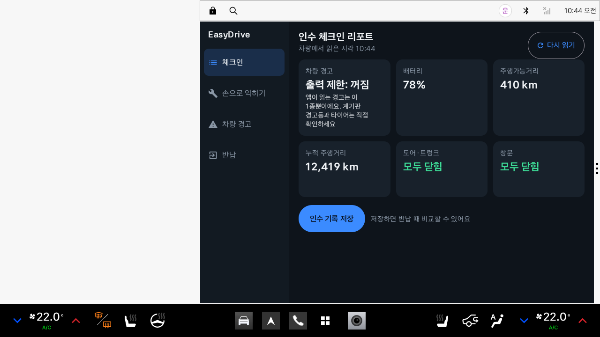
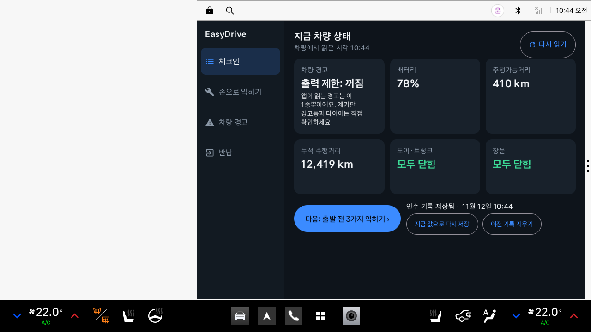
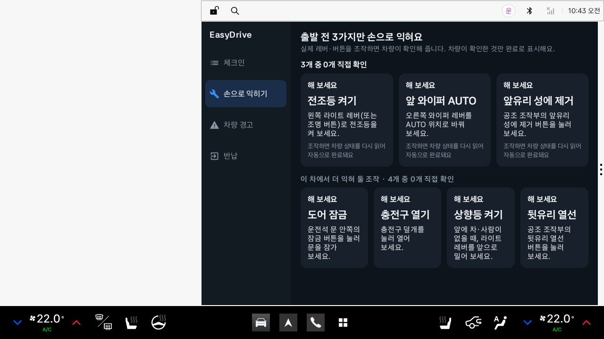
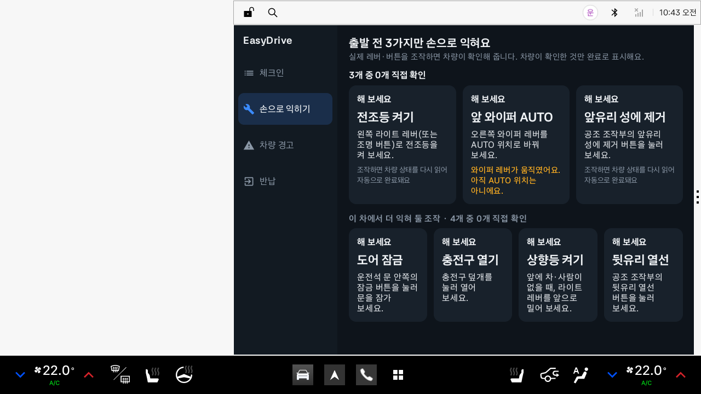
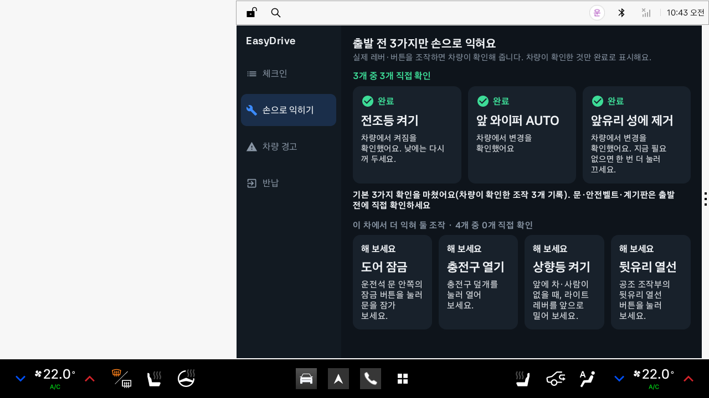
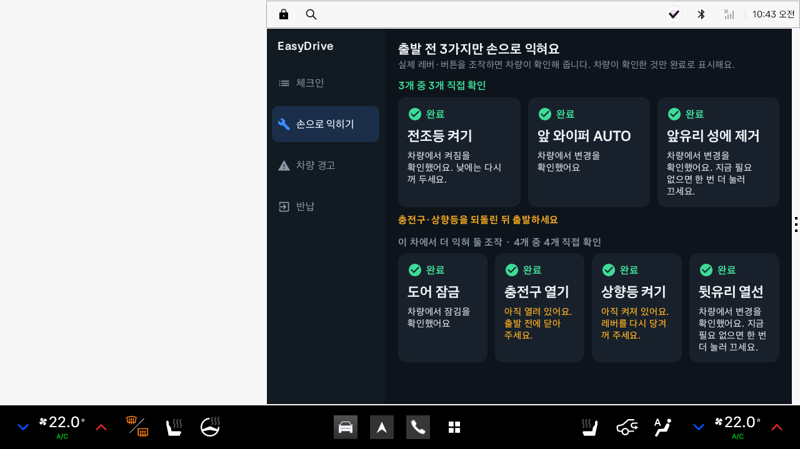
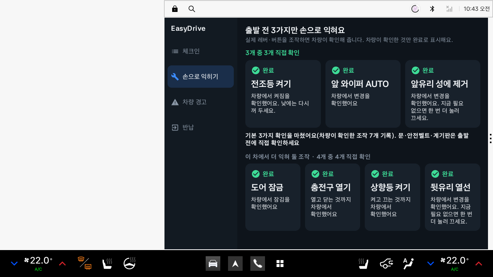
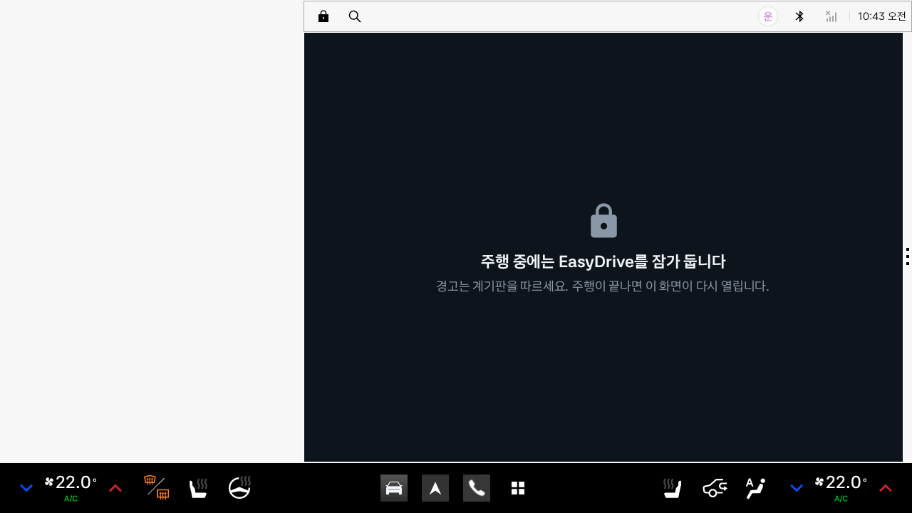
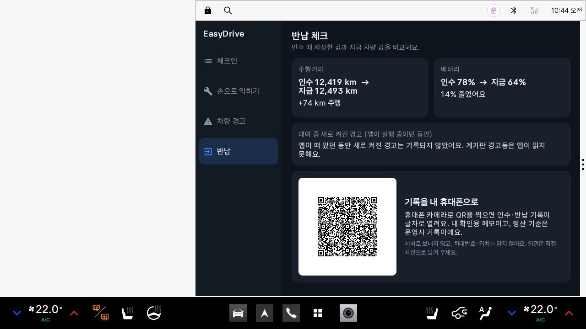
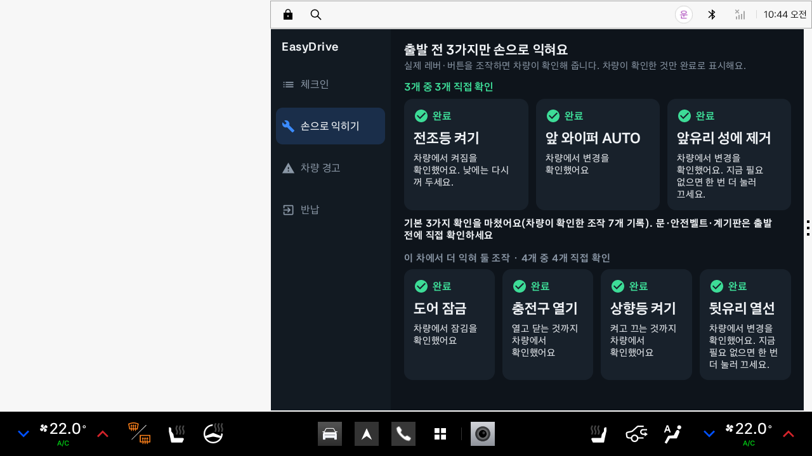

# EasyDrive (이지드라이브)

> 처음 타는 Pleos 차에서 출발 전에 전조등·와이퍼·성에 제거 3가지를 직접 조작하면, 차가 ‘맞게 했다’고 확인해 주는 **첫 탑승 실습 앱**입니다. 차량 상태도 한눈에 요약해 보여 줍니다.

현대자동차그룹 차량용 앱 개발 공모전(Pleos Connect) 출품작입니다.

## APK 위치

- `apk/PersonalEntry_EasyDrive_release.apk` (release 빌드, APK 서명 v3)

## 주요 기능

| 화면 | 하는 일 | 사용하는 차량 데이터 |
|---|---|---|
| 체크인 | 차량 경고, 배터리·연료 잔량, 주행가능거리, 누적 주행거리, 도어·트렁크·창문 상태를 요약하고 인수 기록으로 저장. 내비게이션이 길 안내 중이면 목적지까지 남은 거리를 함께 표시하도록 구현(에뮬레이터에서는 응답을 받지 못함) | Vehicle SDK(Safety, EvBattery·Fuel, Odometer, Door, Window), NaviHelper SDK |
| 손으로 익히기 | 기본 3과제(전조등 · 앞 와이퍼 AUTO · 앞유리 성에 제거)와, 차가 확인해 줄 수 있을 때만 나오는 ‘더 익혀 둘 조작’ 4개(도어 잠금 · 충전구 열기 · 상향등 켜기 · 뒷유리 열선). 사용자가 실제 레버·버튼을 조작하면 앱이 차량 값을 다시 읽어 완료 처리 | Vehicle SDK(Light, Wiper, HVAC, EvBattery, Door, Gear) |
| 차량 경고 | 차량이 알려 주는 경고 상태를 ‘무슨 뜻 / 먼저 할 일’로 풀어 설명. 주행 중 새로 켜진 경고는 기록만 했다가 주차 후 카드로 안내(앱이 화면에 떠 있던 동안만 기록) | Safety |
| 반납 | 인수 기록과 현재 값을 비교(주행거리, 배터리·연료), 대여 중 새로 켜진 경고 이력 표시. **인수·반납 기록과 차량이 확인한 조작 목록을 QR로 만들어 휴대폰 카메라로 가져가기**(서버 전송 없음) | Odometer, EvBattery·Fuel, Safety |

### 손으로 익히기가 지키는 규칙

- **차량이 확인한 것만 완료**: 화면 버튼으로는 완료할 수 없습니다. 차량 값이 바뀌어야 체크가 붙습니다.
- **이미 맞춰져 있던 과제는 완료로 세지 않음**: ‘이미 설정됨 · 위치만 확인’으로 따로 표시하고, 진행 문구도 ‘3개 중 2개 직접 확인 · 1개는 이미 설정됨’처럼 나눠 셉니다.
- **차에 맞춰 바뀜**: 전조등 스위치에 AUTO 위치가 있으면 ‘전조등 AUTO’, 없으면 ‘전조등 켜기’. 앱이 이 차에서 상태를 읽을 수 없는 조작은 과제 수에서 빼고 ‘앱이 확인할 수 없는 조작’이라고 표시합니다(차에 그 기능이 없다는 뜻이 아닙니다).
- **엉뚱한 위치 안내**: 와이퍼 레버가 움직였는데 AUTO가 아니면 ‘와이퍼 레버가 움직였어요. 아직 AUTO 위치는 아니에요.’라고 알려 줍니다.
- **되돌림 확인**: 충전구·상향등은 완료 뒤에도 계속 읽어, 열려·켜져 있으면 주황색으로 ‘아직 열려 있어요. 출발 전에 닫아 주세요.’와 ‘충전구·상향등을 되돌린 뒤 출발하세요’를 보여 주고, 되돌리면 ‘열고 닫는 것까지 차량에서 확인했어요’로 바뀝니다.
- **‘출발 준비 완료’라고 하지 않음**: 과제를 마쳐도 앱이 보지 않는 것이 많습니다. 기본 3과제를 마치면 ‘문·안전벨트·계기판은 출발 전에 직접 확인하세요’라고 적습니다.
- **기어 P에서만**: 기어를 읽을 수 있는 차에서는 P단일 때만 과제를 엽니다(주행 규제 잠금과 별개로, 더 엄격한 쪽으로만 씁니다).
- **기록에 남김**: 차량이 확인한 조작의 이름을 기기에 저장해 반납 화면의 QR 기록에 함께 넣습니다.

### 읽는 차량 경고 7종

공개 권한 `CAR_SAFETY`로 읽을 수 있는 경고 상태만 사용합니다.

| 경고 | Vehicle SDK API |
|---|---|
| 안전벨트 미착용 | `hasSeatBeltNotBuckledWarning` |
| 워셔액 부족 | `hasLowWasherFluidWarning` |
| 출력 제한 | `hasPowerDownWarningIndicator` |
| 엔진 오일 | `getEngineOilLevelState` |
| 브레이크액 | `getBrakeFluidLevelState` |
| 변속기 오일 | `getTransmissionOilLevelState` |
| 에어백 전개 이력 | `hasSeatAirbagBeenDeployed` |

계기판 경고등 전체 목록은 SDK 2.3.2에서 조회 API(`getTelltalesInfo`)가 `CAR_SAFETY` 표시이고 지원 확인 API(`checkTelltalesCapabilities`)가 `PRIVATE_CAR_SAFETY` 표시입니다. 앱은 **PRIVATE 표시가 붙은 API는 부르지 않고**, `getTelltalesInfo`만 한 번 불러 봅니다. 에뮬레이터 v2.1.0에서는 `getTelltalesInfo need Permission`으로 거절되었고, 거절되면 다시 부르지 않고 위 7종만 읽습니다. 타이어 공기압(`getTirePressure`)은 쓰지 않습니다.

읽은 경고가 한두 종뿐일 때는 ‘경고 없음’이라고 쓰지 않습니다. 차 전체가 정상이라는 뜻으로 읽히기 때문입니다. 대신 ‘출력 제한: 꺼짐’처럼 읽은 것만 중립색으로 말하고, 그 아래에 ‘앱이 읽는 경고는 이 1종뿐이에요. 계기판 경고등과 타이어는 직접 확인하세요’를 적습니다. 3종 이상 읽히는 차에서만 ‘경고 없음(읽은 경고 N종 기준)’을 씁니다. 안전벨트 미착용은 출발 전 주차 상태에서 흔히 켜져 있으므로 ‘확인 필요’로 세지 않습니다.

**Pleos Connect Emulator v2.1.0에서는 7종 가운데 ‘출력 제한’ 1종만 읽힙니다.** 나머지 6종은 지원 여부 확인 단계에서 `ERROR_NOT_SUPPORTED_PROPERTY`가 돌아와 ‘지원 안 함’으로 처리됩니다.

## 앱 화면

### Pleos Connect Emulator v2.1.0에서 실행한 화면

**아래 11장은 모두 이 저장소의 `apk/PersonalEntry_EasyDrive_release.apk`(최종 APK)를 에뮬레이터에 설치해 찍은 화면입니다.** 값은 Virtual Console로 넣은 것을 앱이 Vehicle SDK로 읽은 결과입니다.

캡처 환경은 하드웨어 가속이 없는 서버라서 에뮬레이터 화면을 **1280×720 픽셀·80dpi**로 설정했습니다. 원래 규격(2560×1440 픽셀·160dpi)과 dp 크기가 같아서, 앱은 원 해상도와 같은 홈 화면 오른쪽 패널에 같은 배치로 뜹니다. 위·아래 시스템 바는 함께 찍혔고, 왼쪽 홈 영역은 이 환경에서 그려지지 않아 비어 있습니다. 캡처는 두 번의 실행에 걸쳐 찍어서 화면 속 시각과 누적 주행거리가 이어지지 않는 곳이 있습니다(1·2·10번이 뒤 실행).

| 1. 체크인 리포트 — Virtual Console에 넣은 배터리 78% · 410km가 그대로 표시됨 |
|---|
|  |

| 2. 인수 기록 저장 후 |
|---|
|  |

| 3. 실습 시작 — 기본 3과제 + 이 차가 확인해 줄 수 있는 추가 4과제 |
|---|
|  |

| 4. 와이퍼를 Low로: ‘와이퍼 레버가 움직였어요. 아직 AUTO 위치는 아니에요.’ |
|---|
|  |

| 5. 기본 3과제 완료 |
|---|
|  |

| 6. 추가 4과제까지 완료. 충전구·상향등이 열려·켜져 있어 주황색으로 ‘충전구·상향등을 되돌린 뒤 출발하세요’ |
|---|
|  |

| 7. 충전구를 닫고 상향등을 끈 뒤: ‘열고 닫는 것까지 차량에서 확인했어요’ |
|---|
|  |

| 8. 기어 D: 화면 잠금 |
|---|
|  |

| 9. 운전석 도어·트렁크 열림: ‘▲ 열림 2곳’ (이 실행에서는 인수 기록을 저장하지 않은 상태) |
|---|
|  |

| 10. 반납 비교와 QR |
|---|
|  |

| 11. 기어 D → P로 돌아온 뒤 실습 화면: 완료 상태와 과제 이름이 그대로 |
|---|
|  |

10번 화면의 QR은 캡처 이미지를 QR 판독기(OpenCV)로 읽어 아래 문구가 그대로 나오는 것을 확인했습니다.

```
EasyDrive 기록
인수 11-12 10:44 / 12,419km / 배터리 78% / 앱이 읽은 경고 없음
지금 11-12 10:44 / 12,493km(+74) / 배터리 64%
대여 중 앱이 기록한 경고 없음
차량이 확인한 조작 7개: 앞유리 성에 제거, 전조등 켜기, 앞 와이퍼 AUTO, 도어 잠금, 충전구 열기, 상향등 켜기, 뒷유리 열선
```

‘앱이 읽은 경고 없음’은 앱이 읽는 경고(에뮬레이터에서는 출력 제한 1종) 가운데 켜진 것이 없었다는 뜻입니다. 계기판 경고등은 앱이 읽지 못하므로 기록 대상이 아닙니다.

### 화면 코드 렌더링

아래 이미지는 **실제 Compose 화면 코드를 JVM(Robolectric)에서 그린 결과**이며 차량 값은 테스트용 가짜 응답입니다(전조등 AUTO 위치가 있는 차를 가정). 에뮬레이터에서 재현할 수 없는 상태를 보여 주기 위한 것입니다. `./gradlew testDebugUnitTest -Pscreens --tests "*ScreenshotTest*"` 로 다시 만들 수 있습니다.

| 차량 경고 풀이(주행 중 경고가 켜졌던 경우) | 반납 체크(경고 이력이 있는 경우) |
|---|---|
|  |  |

- 전체 화면(2560×1440dp)으로 뜰 때(이미지는 절반 크기): `docs/screens/6_checkin_2560x1440.png`
- 좁은 창(1280×1440dp)에서의 세로 배치(이미지는 절반 크기): `docs/screens/7_checkin_split_1280x1440.png`

## 설계 원칙

- **읽기 전용**: 차량을 제어하지 않습니다. `CONTROL_*`·`PRIVATE_*` 권한을 선언하지 않고 `set`·`move` 계열 API를 호출하지 않습니다.
- **확인되지 않은 것은 정상이 아님**: 지원 확인 API가 있는 항목은 먼저 지원 여부를 확인합니다(주행가능거리는 SDK에 확인 API가 없어 바로 읽습니다). 미지원은 ‘지원 안 함’, 권한 오류·응답 없음(3초)·null은 ‘확인 불가’로 표시하며 0이나 정상값으로 채우지 않습니다. 도어·창문은 일부만 읽혔는데 열린 곳이 없으면 ‘모두 닫힘’이 아니라 ‘확인 불가’로 표시합니다.
- **주행 규제 준수**: `CarUxRestrictionsManager`에서 받은 `CarUxRestrictions.isRequiresDistractionOptimization()`이 참이면 전체 화면을 잠급니다. 규제 상태를 알 수 없을 때도 잠금을 유지합니다. 잠금 여부는 앱이 속도·기어로 직접 판단하지 않고 시스템의 주행 규제 신호만 따릅니다. 에뮬레이터 v2.1.0에서는 기어 D(속도 0 포함)·R·N에서 잠기고 P에서 풀렸습니다. 실습 과제는 여기에 더해 기어가 P일 때만 엽니다. `MainActivity`는 `distractionOptimized`로 선언해, 주행 중 시스템이 화면을 가리는 대신 앱이 직접 잠금 화면을 보여 줍니다(주행 중에도 앱이 떠 있어야 켜진 경고를 기록할 수 있기 때문이며, 잠금 화면에는 조작할 것이 없습니다).
- **주행 중 방해 없음**: 주행 중 켜진 경고는 화면에 띄우지 않고 기록만 합니다. 경고 표시는 계기판이 담당합니다. 별도 백그라운드 서비스는 없습니다. 경고 조회는 앱 프로세스가 살아 있는 동안 2초마다 돌지만, 기록이 보장되는 것은 앱이 화면에 떠 있던 동안뿐입니다.
- **개인정보 최소화**: 서버·계정이 없습니다. VIN·위치 등 식별정보를 저장하지 않으며, 인수 기록은 기기 안(SharedPreferences)에만 저장합니다. 기록을 밖으로 꺼내는 방법은 화면의 QR을 운전자가 직접 찍는 것뿐입니다. 반납 화면에서 기록을 지울 수 있습니다.
- **차량 화면에 맞춘 크기**: 창 크기에 맞춰 화면 전체 배율을 정합니다(기준 높이 720dp, 1~2.5배). 에뮬레이터의 오른쪽 패널(사용 영역 1682×1210dp)에서는 가로 3칸 배치가 들어가도록 폭 기준(1100dp)에 맞춘 약 1.5배, 전체 화면(2560×1440)에서는 2배입니다. 폭이 좁은 창에서는 메뉴를 위로 올리고 카드를 세로로 쌓습니다. 버튼 높이는 기준 배율에서 76dp(보조 버튼 60dp)입니다.
- **시스템 바에 가려지지 않게**: Pleos Connect 에뮬레이터는 위·아래 시스템 바를 앱 창 위에 겹쳐 그리면서 인셋을 창에 전달하지 않습니다. 앱이 창 영역과 쓸 수 있는 높이를 비교해 가려지는 부분을 직접 비웁니다.
- **한글 줄바꿈**: 낱말 중간(‘성/에 제거’)에서 줄이 바뀌지 않게 띄어쓰기에서만 줄을 바꿉니다.

## 사용 SDK / API

- Pleos Connect **Vehicle SDK 2.3.2** (`ai.pleos.playground:Vehicle:2.3.2`, Vehicle State – 별도 신청 불필요)
  - Safety: 위 표의 경고 7종과 각 `check…Capabilities`, `getTelltalesInfo`(한 번 시도, 거절되면 다시 부르지 않음)
  - Gear: `getCurrentGearSelectionState` (실습 과제를 P단에서만 열기 위해)
  - Odometer: `getCurrentDistanceDriven`, `getRangeRemainingDistance`
  - EvBattery: `getEvBatteryStateOfCharge` / Fuel: `getFuelPercent` (배터리 잔량을 지원하지 않거나 읽지 못하는 차에서 연료 잔량을 대신 표시)
  - Door: `checkDoorPositionCapabilities`, `getCurrentDoorPosition`, `checkDoorLockCapabilities`, `getDoorLockState` / Window: `checkWindowPositionCapabilities`, `getCurrentWindowPosition`
  - Light: `checkLowBeamLightSwitchCapabilities`, `getLowBeamLightSwitch` (스위치를 읽을 수 없는 차에서는 `checkLowBeamLightStateCapabilities`, `getCurrentLowBeamLightState`), `checkHighBeamLightSwitchCapabilities`, `getHighBeamLightSwitch`
  - EvBattery(충전구): `checkEvChargePortOpenCapabilities`, `isEvChargePortOpen`
  - Wiper: `checkWiperSwitchCapabilities`, `getCurrentWiperSwitch`
  - HVAC: `checkHvacDefrosterCapabilities`, `getHvacDefrosterState`, `registerHvacDefrosterState`
- Pleos Connect **NaviHelper SDK 3.0.5** (`ai.pleos.playground:NaviHelper:3.0.5`) – `initialize`, `getRouteStateInfo`, `getDestinationInfo`. 길 안내 중인 목적지까지 남은 거리만 읽고, 경로를 요청하거나 바꾸지 않습니다.
- Android Automotive `android.car` – `CarUxRestrictionsManager` (차량 서비스가 늦게 준비되거나 끊겨도 기다리지 않고 자동으로 다시 연결)
- ZXing core 3.5.3 – QR 생성(기기 안에서만)

선언 권한(모두 읽기용 공개 권한 7개): `pleos.car.permission.CAR_SAFETY`, `CAR_LIGHTS`, `CAR_WINDOWS`, `CAR_CLIMATE`, `CAR_DRIVE`, `CAR_ENERGY`, `CAR_DOORS`. SDK 2.3.2가 위 API에 표시한 권한만 선언했고, 이 구성으로 에뮬레이터에서 모든 값이 읽히는 것을 확인했습니다. 제어(`CONTROL_*`)·비공개(`PRIVATE_*`) 권한은 없습니다.

변경 알림 구독은 앞유리 성에 제거(`registerHvacDefrosterState`) 1종에만 쓰고, 나머지는 주기 조회입니다(경고 2초, 실습 1초, 체크인 6초). 전조등·와이퍼 스위치는 SDK에 변경 알림이 없습니다. 경고 7종과 도어는 알림 API가 있어 구독으로 바꿀 수 있으며, 다음 단계 과제로 남겼습니다.

차량 서비스 연결이 끊기면 10초 간격으로 다시 연결을 시도합니다.

## 실행 방법

### 1) APK 설치

1. Android Studio에 Pleos Connect Emulator를 설치하고 실행합니다. ([설치 가이드](https://document.pleos.ai/docs/connect/guide/getting-started/application-development/setup-connect-sdk-emulator))
2. 터미널에서 설치합니다.
   ```bash
   adb install -r apk/PersonalEntry_EasyDrive_release.apk
   ```
3. 런처에서 **EasyDrive**를 실행합니다.

### 2) 소스에서 빌드

- 요구 사항: JDK 17 이상, Android SDK 35, Gradle Wrapper(8.10.2 포함)
- 저장소 루트에서:
  ```bash
  ./gradlew assembleDebug        # 디버그 빌드
  ./gradlew installDebug         # 실행 중인 에뮬레이터에 설치
  ```
- release 서명은 저장소에 포함하지 않은 `keystore.properties`(storeFile, storePassword, keyAlias, keyPassword)가 있을 때만 적용됩니다.

## 테스트 환경 및 설정

- **Pleos Connect 에뮬레이터 버전: v2.1.0** (SDK Manager 패키지 `system-images;android-34;pleos_car_emulator;x86_64`, Android 14 · API 34)
- **화면 규격: 2560×1440 px, 160dpi(mdpi), 12.8형 가로** — 에뮬레이터에 들어 있는 기기 정의 값이며, 앱 배율과 화면 캡처 테스트의 기준입니다.
- Pleos Connect **Virtual Console**: `adb forward tcp:8088 tcp:8088` 후 PC 브라우저에서 `http://127.0.0.1:8088/`
- 빌드 환경: compileSdk/targetSdk 35, minSdk 28, Kotlin 2.0.21, AGP 8.8.2, Jetpack Compose

### 에뮬레이터에서 확인한 것 (2026-11-13, Pleos Connect Emulator v2.1.0, 최종 APK)

캡처 화면에 보이는 날짜·시각은 에뮬레이터 안의 시계 기준이라 실제 확인 시각과 다릅니다. 화면은 1280×720 픽셀·80dpi로 설정했습니다(원 규격과 같은 dp 크기, 위 ‘앱 화면’ 참고).

이 저장소의 release APK를 설치하고 Virtual Console로 값을 바꿔 가며 **앱 화면과 로그로** 확인했습니다.

| 항목 | 결과 |
|---|---|
| 설치·실행 | `adb install` 성공, 홈 화면 오른쪽 패널에서 가로 3칸 배치로 실행. 7개 과제 카드가 스크롤 없이 한 화면에 보임 |
| 창 크기 | 앱 창 1684×1348dp(80dpi 설정에서 보고된 값. 원 규격에서는 1682×1350dp), 시스템 바를 뺀 사용 영역 약 1682×1210dp |
| 차량 값 읽기 | 배터리 SOC, 주행가능거리(미터 단위), 누적 주행거리: Virtual Console에서 바꾼 값이 화면에 반영됨 |
| 도어·트렁크 | Door(Front left) = **Open**, Trunk = **Open** → 체크인 화면에 ‘▲ 열림 2곳 · 트렁크, 운전석 도어’ |
| 실습: 전조등 | 에뮬레이터는 스위치 선택지로 `[OFF, ON]`만 알려 줌(AUTO 없음) → 과제가 ‘전조등 켜기’로 바뀜. Exterior Lights Mode = **Low beam** → 완료 |
| 실습: 앞 와이퍼 | Windshield Wiper Switch(Front) = **Low** → ‘아직 AUTO 위치는 아니에요’ 안내, **Auto** → 완료 |
| 실습: 성에 제거 | Defroster(Front) = **On** → 완료 |
| 실습: 추가 4과제 | Door Lock = **Lock**, Charge Port = **Open**, High Beam = **On**, Defroster(Rear) = **On** → 각각 완료. 충전구·상향등이 열려·켜져 있는 동안 ‘되돌린 뒤 출발하세요’, 닫고 끄면 ‘열고 닫는 것까지/켜고 끄는 것까지 차량에서 확인했어요’ |
| 실습 유지 | 주행 잠금을 다녀와도 완료 상태와 과제 이름(‘전조등 켜기’)이 그대로 유지됨 |
| 주행 규제 | Gear = **D**(속도 0), **R**, **N** → 시스템 주행 규제가 켜져 잠금, Gear = **P** → 해제 |
| 인수 기록·반납 | 저장 후 ‘인수 기록 저장됨’, 반납 화면에 ‘인수 12,419 km → 지금 12,493 km, +74 km 주행’, ‘인수 78% → 지금 64%’ |
| QR | 반납 화면 캡처의 QR을 판독기로 읽어 기록 문구(차량이 확인한 조작 7개 포함)가 그대로 나오는 것을 확인 |
| 차량 경고 | 공개 7종 중 출력 제한만 읽힘, 나머지 6종은 `ERROR_NOT_SUPPORTED_PROPERTY`. `getTelltalesInfo`는 ‘need Permission’으로 거절됨 |
| 권한 | 읽기 권한 7개만 선언한 APK로 위 항목이 모두 동작 |
| NaviHelper | 내비게이션 서비스(3.0.4)에 연결되고 조회 요청까지 감. 길 안내 상태 응답은 받지 못함(에뮬레이터에서 경로를 설정할 방법을 찾지 못함) |

에뮬레이터에서 확인하지 못한 것:

- **경고가 켜지는 흐름**: Virtual Console의 Telltales › PowerDown을 켜도 앱이 읽는 출력 제한 값은 바뀌지 않았습니다. ‘주행 중 켜진 경고를 기록했다가 주차 후 안내’는 자동 테스트로만 검증했습니다.
- **내비 목적지 표시**: 길 안내 중일 때 남은 거리가 어떤 단위로 오는지(미터로 가정) 확인하지 못했습니다. 응답이 없으면 화면에 아무것도 표시하지 않습니다.
- **2560×1440 픽셀 실행**: 이 환경에서는 시스템 UI가 종료되어 실행하지 못했습니다. dp 크기가 같은 1280×720·80dpi로 대신 확인했습니다.
- **끊기지 않는 화면 녹화**: 화면 캡처가 자주 끊겨 정지 화면으로만 남겼습니다.
- **실제 휴대폰으로 QR 촬영**: 캡처 이미지를 판독기로 읽는 것까지만 확인했습니다.
- **실차**: 실차에서는 확인하지 못했습니다.

에뮬레이터에서 실행해 보고 찾아 고친 문제:

- 위·아래 시스템 바가 앱 창을 덮어 제목과 버튼이 가려짐 → 가려지는 영역을 앱이 계산해 비움
- 부팅 직후 차량 서비스가 준비되기 전에 실행하면 주행 규제 연결이 실패해 잠금이 풀리지 않음 → 기다리지 않는 연결 방식으로 바꾸고 자동 재연결
- 전조등 스위치에 AUTO 선택지가 없어 과제가 ‘지원 안 함’이 됨 → ‘전조등 켜기’로 과제를 바꿈
- ‘전조등 켜기’로 완료한 뒤 화면을 다시 열면 제목이 ‘전조등 AUTO’로 돌아감 → 완료한 과제는 그대로 유지
- 차가 갖고 있지 않은 경고 항목을 2초마다 다시 확인함 → ‘지원 안 함’으로 기억
- 오른쪽 패널 크기에서 카드 글자가 겹침 → 그 크기에 맞춘 배율 규칙 추가

화면을 지정해 바로 열 수 있습니다(시연·점검용): `adb shell am start -n com.easydrive.app/.ui.MainActivity --es tab practice` (`checkin`·`practice`·`warnings`·`return`)

## 자동 테스트 (에뮬레이터 없이 JVM에서 실행)

차량 응답을 흉내 낸 가짜 게이트웨이로 앱 로직을 검증합니다(총 62건). 에뮬레이터에서 한 확인과는 별개입니다.

- `AppControllerTest.kt` 37건 — 체크인·차량 경고 감시·실습·주행 규제·인수/반납
- `HandoverRecordTest.kt` 7건 — 인수·반납 기록 문구, 차량이 확인한 조작 목록, QR을 다시 읽었을 때 한글 기록이 그대로 나오는지
- `UiScaleTest.kt` 18건 — 화면 크기별 배율, 좁은 화면 판정, 시스템 바 영역 계산(에뮬레이터에서 받은 구성 정보 사용), 내비 목적지 안내 문구, 실습 진행 문구(이미 설정됨을 따로 셈), 과제를 마친 뒤의 안내(‘출발해도 된다’고 하지 않음), 낱말 단위 줄바꿈

```bash
./gradlew testDebugUnitTest
```

| 확인하는 것 | 예 |
|---|---|
| 읽지 못한 값을 채우지 않음 | 조회 실패는 ‘경고 없음’이 아니라 ‘확인 불가’, 미지원과 구분 |
| 공개 권한만으로 동작 | 경고등 전체 조회가 권한 없음으로 거절되면 공개 경고 7종으로 읽고, 범위를 화면에 표시 |
| 주행 규제 | 규제 중(또는 상태 불명) 새로 켜진 경고는 기록만 하고 ‘주행 중’ 표시, 중복 기록 없음 |
| 실습 과제 | 대기 → 차량 값이 바뀌면 완료 / 이미 설정됨 / 지원 안 함 / 확인 불가 구분, 재시도 후 회복, AUTO가 없는 차에서는 ‘전조등 켜기’로 전환하고 화면을 다시 열어도 유지, 와이퍼가 AUTO가 아닌 위치면 안내만 하고 완료하지 않음, 충전구는 닫을 때까지 지켜봄, 기어가 P가 아니면 과제를 닫고 그동안의 조작은 세지 않음 |
| 연결 지연·끊김 | 첫 조회가 실패해도 자동 재시도로 리포트가 채워지고, 감시 도중 실패가 이어지면 ‘확인 불가’로 바뀜 |
| 인수·반납 | 읽지 못한 항목은 null로 저장, 다시 저장하면 이전 이력 정리, 반납 후 기록 삭제 |
| 읽기 전용 | 게이트웨이에 set·move·control 계열 공개 메서드가 없음 |
| QR 기록 | 읽지 못한 값은 ‘확인 불가’, 식별정보 항목 없음, QR 디코딩 결과가 원문과 일치 |
| 화면 배율 | 2560×1440에서 2배, 오른쪽 패널(1682×1210)에서 가로 배치 유지, 좁은 창(1280×1440)에서 세로 배치 |

화면 캡처 테스트(선택): `app/src/screens/.../ScreenshotTest.kt` — 실제 화면 코드를 5개 화면과 여러 화면 크기(Pleos 오른쪽 패널 1682×1210, 2560×1440, 좁은 창 1280×1440, 작은 화면)에서 그려 `app/build/screens`에 PNG로 저장합니다. 내려받을 라이브러리가 커서 `-Pscreens`를 줄 때만 실행됩니다. `DemoFramesTest.kt`는 시연 영상에 쓴 장면을 같은 방식으로 그립니다.

이 테스트가 보증하는 것은 ‘앱이 어떤 응답에도 약속대로 반응하는가’입니다. Pleos SDK가 실제로 어떤 응답을 주는지는 위 ‘에뮬레이터에서 확인한 것’에 따로 적었습니다.

### Virtual Console로 따라 해 보는 순서

Virtual Console은 브라우저로 열어 둔 동안에만 값을 에뮬레이터에 보냅니다. 항목 이름은 v2.1.0의 API 목록 기준입니다.

| 순서 | Virtual Console 조작 | EasyDrive에서 확인할 것 |
|---|---|---|
| 1 | Motion › Gear Selection = **P** | 잠금이 풀리고 체크인 리포트가 표시됨 |
| 2 | EV Battery › Battery SOC, Energy › Remaining Range, Odometer › Odometer 값 변경 | 리포트 값이 바뀜(6초 안에 자동 갱신), ‘인수 기록 저장’ |
| 3 | Light › Exterior Lights Mode = **Low beam** | 실습 ‘전조등 켜기’가 **완료** |
| 4 | Wiper › Windshield Wiper Switch(Front) = **Auto** | 실습 ‘앞 와이퍼 AUTO’가 **완료** |
| 5 | Climate › Defroster(Front) = **On** | 실습 ‘앞유리 성에 제거’가 **완료** |
| 5-1 | Door › Door Lock = **Lock**, EV Battery › Charge Port = **Open**, Light › High Beam = **On**, Climate › Defroster(Rear) = **On** | ‘더 익혀 둘 조작’ 4개가 차례로 **완료**. 충전구를 닫고 상향등을 끄면 안내 문구가 바뀜 |
| 6 | Door › Door Position(또는 Trunk) = **Open** | 체크인 ‘도어·트렁크’가 ‘▲ 열림’으로 바뀜 |
| 7 | Gear = **D** → 다시 **P** | D에서는 잠금 화면(속도 0에서도), P에서 다시 열림 |
| 8 | Odometer·SOC 변경 후 반납 화면 | 인수 대비 주행거리·배터리 변화, QR을 휴대폰으로 찍으면 같은 기록이 글자로 열림 |

1~8번 모두 최종 APK로 에뮬레이터 화면에서 확인했습니다(8번의 QR은 캡처 이미지를 판독기로 읽어 확인).

## 폴더 구조

```
app/src/main/java/com/easydrive/app/
├─ EasyDriveApp.kt              # 앱 시작 시 차량 서비스·주행 규제 연결
├─ vehicle/VehicleGateway.kt    # Vehicle SDK 호출(읽기 전용) → Read(Ok/Unsupported/Unavailable)
├─ vehicle/NaviGateway.kt       # NaviHelper SDK로 목적지까지 남은 거리 읽기(읽기 전용)
├─ vehicle/DrivingRestriction.kt# CarUxRestrictionsManager 기반 잠금 상태
├─ domain/AppController.kt      # 체크인·차량 경고 감시·실습 과제 로직
├─ domain/TelltaleGuide.kt      # 경고 풀이 사전(‘무슨 뜻 / 먼저 할 일’)
├─ domain/HandoverRecord.kt     # 인수·반납 기록 문구 + QR 생성
├─ data/CheckinStore.kt         # 인수 기록·경고 이력 로컬 저장
└─ ui/MainActivity.kt           # Compose 화면 4개 + 잠금 화면, 화면 배율
app/src/test/                   # 자동 테스트(가짜 차량 응답)
app/src/screens/                # 화면 캡처 테스트(-Pscreens)
apk/                            # release APK
docs/screens/                   # README용 화면 이미지
```

## 알려진 제한

- 경고 풀이 문구는 일반적인 안전 수칙 수준의 요약이며, 차량 계기판 메시지·설명서·운영사 안내가 우선합니다(앱 화면에도 표시).
- 읽는 경고는 위 7종뿐이고, 에뮬레이터 v2.1.0에서는 그중 1종만 읽힙니다. 타이어 공기압·엔진 경고등 같은 계기판 경고등은 앱이 알 수 없습니다.
- 과제 안내는 ‘왼쪽 라이트 레버(또는 조명 버튼)’처럼 차종 공통 문구입니다. 이 차의 레버 위치 그림은 들어 있지 않습니다.
- 인수 기록은 운전자가 지워야 지워집니다. 3일 넘은 기록에는 ‘내 기록이 아니면 지우고 새로 저장하세요’ 안내가 붙습니다.
- 주행가능거리는 미터 단위로 받아 km로 변환합니다(에뮬레이터에서 500000.0 → 500km로 확인).
- 경고 기록은 앱이 화면에 떠 있던 동안만 수집됩니다(반납 화면에도 그렇게 표시). 내비게이션 등 다른 앱을 앞에 띄우고 주행하면 그동안의 경고는 기록되지 않습니다.
- 일부 SDK 호출(도어·창문·전조등·와이퍼·성에 제거 capability 확인, 주행가능거리)은 SDK 2.3.2에서 deprecated 표시가 있는 이전 방식입니다.
- 내비 목적지까지 남은 거리 표시는 에뮬레이터에서 응답을 받지 못해 자동 테스트로만 검증했습니다.
- 음성(TextToSpeech) 연동은 들어 있지 않습니다(Playground 프로젝트 키가 필요).

## 라이선스·출처

- Pleos Connect SDK: Pleos Playground 이용약관에 따름
- AndroidX / Jetpack Compose / Kotlin Coroutines: Apache License 2.0
- ZXing core(QR 생성): Apache License 2.0
- 앱 아이콘과 화면 디자인은 직접 제작했습니다.
