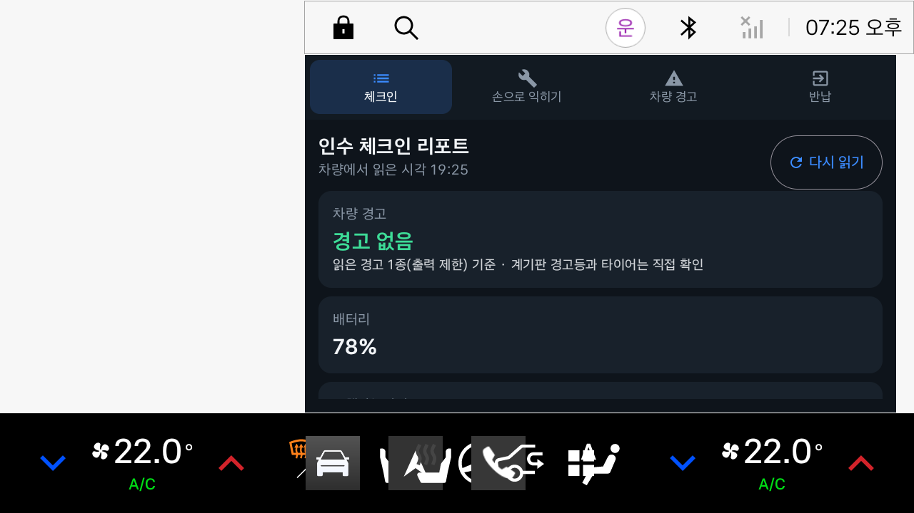
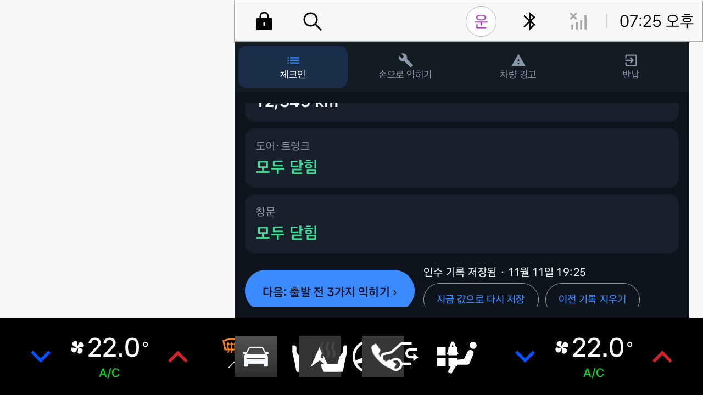
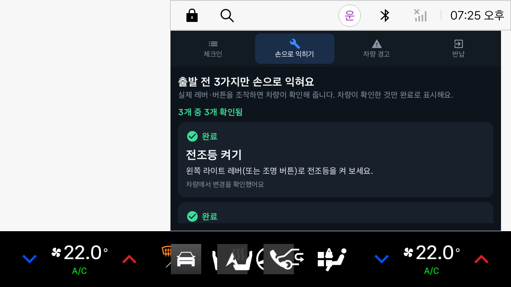
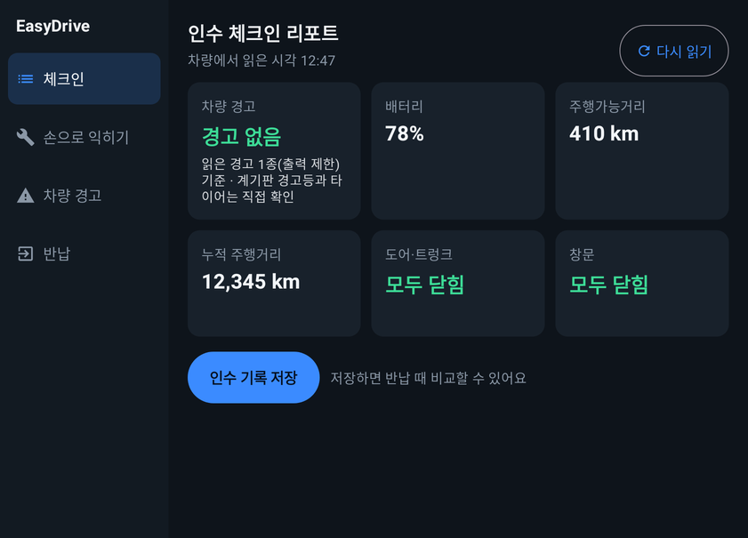
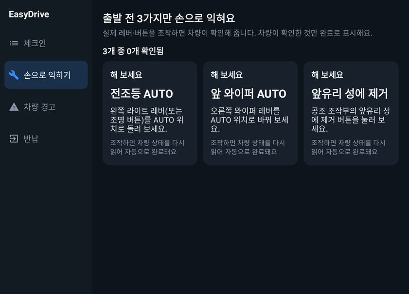
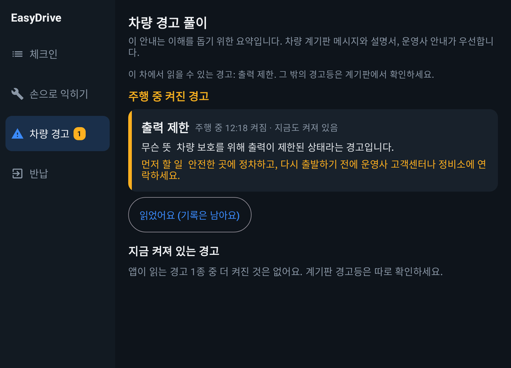
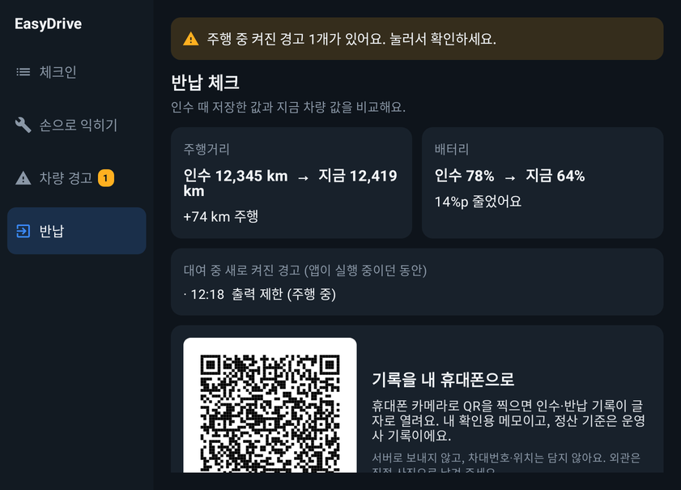

# EasyDrive (이지드라이브)

> 처음 타는 Pleos 차에서 출발 전 3분, 전조등·와이퍼·성에 제거를 직접 조작하면 차가 ‘맞게 했다’고 확인해 주고, 차량 상태를 한 화면으로 읽어 주는 **첫 탑승 체크인 앱**입니다.

현대자동차그룹 차량용 앱 개발 공모전(Pleos Connect) 출품작입니다.

## APK 위치

- `apk/PersonalEntry_EasyDrive_release.apk` (release 빌드, APK 서명 v3)

## 주요 기능

| 화면 | 하는 일 | 사용하는 차량 데이터 |
|---|---|---|
| 체크인 | 차량 경고, 배터리·연료 잔량, 주행가능거리, 누적 주행거리, 도어·트렁크·창문 상태를 한 화면에 요약하고 인수 기록으로 저장 | Safety, EvBattery·Fuel, Odometer, Door, Window |
| 손으로 익히기 | 전조등 · 앞 와이퍼 AUTO · 앞유리 성에 제거 3과제. 사용자가 실제 레버·버튼을 조작하면 앱이 차량 값을 다시 읽어 완료 처리. 전조등은 차가 AUTO 위치를 지원하면 ‘전조등 AUTO’, 아니면 ‘전조등 켜기’로 과제가 바뀜 | Light, Wiper, HVAC |
| 차량 경고 | 차량이 알려 주는 경고 상태를 ‘무슨 뜻 / 먼저 할 일’로 풀어 설명. 주행 중 새로 켜진 경고는 기록만 했다가 정차 후 카드로 안내 | Safety |
| 반납 | 인수 기록과 현재 값을 비교(주행거리, 배터리·연료), 대여 중 새로 켜진 경고 이력 표시. **인수·반납 기록을 QR로 만들어 휴대폰 카메라로 가져가기**(서버 전송 없음) | Odometer, EvBattery·Fuel, Safety |

### 읽는 차량 경고 7종

공개 권한 `CAR_SAFETY`로 읽을 수 있는 경고 상태만 사용합니다.

| 경고 | Vehicle SDK API |
|---|---|
| 안전벨트 미착용 | `hasSeatBeltNotBuckledWarning` |
| 워셔액 부족 | `hasLowWasherFluidWarning` |
| 출력 제한 | `hasPowerDownWarningIndicator` |
| 엔진 오일 | `getEngineOilLevelState` |
| 브레이크액 | `getBrakeFluidLevelState` |
| 변속기 오일 | `getTransmissionOilLevelState` |
| 에어백 전개 이력 | `hasSeatAirbagBeenDeployed` |

계기판 경고등 전체(`getTelltalesInfo`)와 타이어 공기압(`getTirePressure`)은 SDK 2.3.2에서 `PRIVATE_CAR_SAFETY` 권한이 필요해 **사용하지 않습니다.** 차종이 지원하지 않는 항목은 세지 않고, 체크인 화면은 ‘경고 없음’ 아래에 ‘읽은 경고 N종 기준 · 계기판 경고등과 타이어는 직접 확인’이라고 범위를 함께 적습니다.

**Pleos Connect Emulator v2.1.0에서는 7종 가운데 ‘출력 제한’ 1종만 읽힙니다.** 나머지 6종은 지원 여부 확인 단계에서 `ERROR_NOT_SUPPORTED_PROPERTY`가 돌아와 ‘지원 안 함’으로 처리되고, 화면에는 ‘읽은 경고 1종(출력 제한) 기준’으로 표시됩니다(아래 에뮬레이터 캡처 참고).

## 앱 화면

### Pleos Connect Emulator v2.1.0에서 실행한 화면

이 저장소의 `apk/PersonalEntry_EasyDrive_release.apk`를 에뮬레이터에 설치해 찍은 화면입니다. 값은 Virtual Console로 넣은 것(배터리 78%, 주행가능거리 410km, 누적 12,345km)을 앱이 Vehicle SDK로 읽은 결과입니다. 캡처 환경은 하드웨어 가속이 없는 서버여서 에뮬레이터 해상도를 1280×720으로 낮춰 실행했습니다.

| 체크인 리포트 | 인수 기록 저장 후 | 실습 3과제 완료 |
|---|---|---|
|  |  |  |

### 화면 코드 렌더링

아래 이미지는 **실제 Compose 화면 코드를 JVM(Robolectric)에서 그린 결과**이며 차량 값은 테스트용 가짜 응답입니다. 크기는 에뮬레이터 기기 정의(2560×1440)에서 앱에 실제로 주어지는 영역(1682×1210dp)과 같습니다. `./gradlew testDebugUnitTest -Pscreens --tests "*ScreenshotTest*"` 로 다시 만들 수 있습니다.

| 체크인 리포트 | 손으로 익히기 |
|---|---|
|  |  |
| **차량 경고 풀이** | **반납 체크** |
|  |  |

- 주행 중 잠금 화면: `docs/screens/5_locked.png`
- 전체 화면(2560×1440)으로 뜰 때: `docs/screens/6_checkin_2560x1440.png`
- 좁은 창(1280×1440)에서의 세로 배치: `docs/screens/7_checkin_split_1280x1440.png`

## 설계 원칙

- **읽기 전용**: 차량을 제어하지 않습니다. `CONTROL_*`·`PRIVATE_*` 권한을 선언하지 않고 `set`·`move` 계열 API를 호출하지 않습니다.
- **확인되지 않은 것은 정상이 아님**: 모든 항목은 capability를 먼저 확인합니다. 미지원은 ‘지원 안 함’, 권한 오류·응답 없음(3초)·null은 ‘확인 불가’로 표시하며 0이나 정상값으로 채우지 않습니다.
- **주행 규제 준수**: `CarUxRestrictionsManager`에서 받은 `CarUxRestrictions.isRequiresDistractionOptimization()`이 참이면 전체 화면을 잠급니다. 규제 상태를 알 수 없을 때도 잠금을 유지합니다. 앱이 속도·기어를 읽어 직접 판단하지 않고 시스템의 주행 규제 신호만 따릅니다. `MainActivity`는 `distractionOptimized`로 선언해, 주행 중 시스템이 화면을 가리는 대신 앱이 직접 잠금 화면을 보여 줍니다.
- **주행 중 방해 없음**: 주행 중 켜진 경고는 화면에 띄우지 않고 기록만 합니다. 경고 표시는 계기판이 담당합니다.
- **개인정보 최소화**: 서버·계정이 없습니다. VIN·위치 등 식별정보를 저장하지 않으며, 인수 기록은 기기 안(SharedPreferences)에만 저장합니다. 기록을 밖으로 꺼내는 방법은 화면의 QR을 운전자가 직접 찍는 것뿐입니다. 반납 화면에서 기록을 지울 수 있습니다.
- **차량 화면에 맞춘 크기**: 창 크기에 맞춰 화면 전체 배율을 정합니다(기준 높이 720dp, 1~2.5배). 에뮬레이터의 오른쪽 패널(1682×1210dp)에서는 약 1.5배, 전체 화면(2560×1440)에서는 2배입니다. 폭이 좁은 창에서는 메뉴를 위로 올리고 카드를 세로로 쌓습니다. 버튼 높이는 기준 배율에서 76dp(보조 버튼 60dp)입니다.
- **시스템 바에 가려지지 않게**: Pleos Connect 에뮬레이터는 위·아래 시스템 바를 앱 창 위에 겹쳐 그리면서 인셋을 창에 전달하지 않습니다. 앱이 창 영역과 쓸 수 있는 높이를 비교해 가려지는 부분을 직접 비웁니다.

## 사용 SDK / API

- Pleos Connect **Vehicle SDK 2.3.2** (`ai.pleos.playground:Vehicle:2.3.2`, Vehicle State – 별도 신청 불필요)
  - Safety: 위 표의 경고 7종과 각 `check…Capabilities`
  - Odometer: `getCurrentDistanceDriven`, `getRangeRemainingDistance`
  - EvBattery: `getEvBatteryStateOfCharge` / Fuel: `getFuelPercent` (전기차 항목을 지원하지 않는 차에서만 연료로 대체)
  - Door: `checkDoorPositionCapabilities`, `getCurrentDoorPosition` / Window: `checkWindowPositionCapabilities`, `getCurrentWindowPosition`
  - Light: `checkLowBeamLightSwitchCapabilities`, `getLowBeamLightSwitch` (스위치를 읽을 수 없는 차에서는 `checkLowBeamLightStateCapabilities`, `getCurrentLowBeamLightState`)
  - Wiper: `checkWiperSwitchCapabilities`, `getCurrentWiperSwitch`
  - HVAC: `checkHvacDefrosterCapabilities`, `getHvacDefrosterState`, `registerHvacDefrosterState`
- Android Automotive `android.car` – `CarUxRestrictionsManager` (차량 서비스가 늦게 준비되거나 끊겨도 기다리지 않고 자동으로 다시 연결)
- ZXing core 3.5.3 – QR 생성(기기 안에서만)

선언 권한(모두 읽기용 공개 권한): `pleos.car.permission.CAR_SAFETY`, `CAR_LIGHTS`, `CAR_WINDOWS`, `CAR_CLIMATE`, `CAR_DRIVE`, `CAR_ENERGY`, `CAR_DOORS` — SDK가 위 API에 요구하는 7개. 여기에 공식 Vehicle SDK 샘플 앱의 선언을 따라 `CAR_MILEAGE`, `CAR_POWERTRAIN`, `READ_WINDSHIELD_WIPERS`, `CAR_INFO`를 함께 선언했습니다(에뮬레이터 확인은 이 구성으로 했고, 빼도 되는지는 아직 확인하지 않았습니다).

경고 상태는 2초마다 다시 읽고, 체크인 값은 6초마다 조용히 갱신합니다. 차량 서비스 연결이 끊기면 10초 간격으로 다시 연결을 시도합니다.

## 실행 방법

### 1) APK 설치

1. Android Studio에 Pleos Connect Emulator를 설치하고 실행합니다. ([설치 가이드](https://document.pleos.ai/docs/connect/guide/getting-started/application-development/setup-connect-sdk-emulator))
2. 터미널에서 설치합니다.
   ```bash
   adb install -r apk/PersonalEntry_EasyDrive_release.apk
   ```
3. 런처에서 **EasyDrive**를 실행합니다.

### 2) 소스에서 빌드

- 요구 사항: JDK 17 이상, Android SDK 35, Gradle Wrapper(8.10.2 포함)
- 저장소 루트에서:
  ```bash
  ./gradlew assembleDebug        # 디버그 빌드
  ./gradlew installDebug         # 실행 중인 에뮬레이터에 설치
  ```
- release 서명은 저장소에 포함하지 않은 `keystore.properties`(storeFile, storePassword, keyAlias, keyPassword)가 있을 때만 적용됩니다.

## 테스트 환경 및 설정

- **Pleos Connect 에뮬레이터 버전: v2.1.0** (SDK Manager 패키지 `system-images;android-34;pleos_car_emulator;x86_64`, Android 14 · API 34)
- **화면 규격: 2560×1440 px, 160dpi(mdpi), 12.8형 가로** — 에뮬레이터에 들어 있는 기기 정의 값이며, 앱 배율과 화면 캡처 테스트의 기준입니다.
- Pleos Connect **Virtual Console**: `adb forward tcp:8088 tcp:8088` 후 PC 브라우저에서 `http://127.0.0.1:8088/`
- 빌드 환경: compileSdk/targetSdk 35, minSdk 28, Kotlin 2.0.21, AGP 8.8.2, Jetpack Compose

### 에뮬레이터에서 확인한 것 (2026-11-12, Pleos Connect Emulator v2.1.0)

캡처 화면에 보이는 날짜·시각은 에뮬레이터 안의 시계 기준이라 실제 확인 시각과 다릅니다.

release APK를 설치하고 Virtual Console로 값을 바꿔 가며 앱 화면과 로그로 확인했습니다.

| 항목 | 결과 |
|---|---|
| 설치·실행 | `adb install` 성공, 홈 화면 오른쪽 패널에서 실행 |
| 차량 값 읽기 | 배터리 SOC, 주행가능거리(미터 단위), 누적 주행거리: Virtual Console에서 바꾼 값이 화면에 반영됨. 도어 6곳·창문 4곳: 읽힘(열림 반영은 확인하지 못함) |
| 실습: 전조등 | 에뮬레이터는 스위치 선택지로 `[OFF, ON]`만 알려 줌(AUTO 없음) → 과제가 ‘전조등 켜기’로 바뀜. Exterior Lights Mode = **Low beam** → 완료 |
| 실습: 앞 와이퍼 | Windshield Wiper Switch(Front) = **Auto** → 완료 |
| 실습: 성에 제거 | Defroster(Front) = **On** → 완료 |
| 주행 규제 | Gear = **D** + 속도 입력(주행 상태) → 시스템 주행 규제가 켜져 잠금, Gear = **P** → 해제 |
| 인수 기록 | 저장 후 ‘인수 기록 저장됨’ 표시 |
| 차량 경고 | 공개 7종 중 출력 제한만 읽힘, 나머지 6종은 `ERROR_NOT_SUPPORTED_PROPERTY`. 경고등 전체 조회는 ‘need Permission’으로 거절됨(예상한 동작) |
| 창 배치 | 2560×1440에서 앱 창은 (853,90)–(2535,1440), 쓸 수 있는 영역 1682×1210dp. 인셋은 전달되지 않음 |

에뮬레이터에서 확인하지 못한 것:

- **경고가 켜지는 흐름**: Virtual Console의 Telltales › PowerDown을 켜도 앱이 읽는 출력 제한 값은 바뀌지 않았습니다. ‘주행 중 켜진 경고를 기록했다가 정차 후 안내’는 자동 테스트로만 검증했습니다.
- **반납 화면과 QR**: 화면 캡처 환경이 불안정해 에뮬레이터 화면으로는 확인하지 못했습니다(로직과 QR 재판독은 자동 테스트로 검증).
- 2560×1440 해상도에서는 캡처 환경의 한계로 시스템 UI가 종료되어, 창 배치 정보만 확인하고 화면은 1280×720에서 찍었습니다.

에뮬레이터에서 실행해 보고 찾아 고친 문제:

- 위·아래 시스템 바가 앱 창을 덮어 제목과 버튼이 가려짐 → 가려지는 영역을 앱이 계산해 비움
- 부팅 직후 차량 서비스가 준비되기 전에 실행하면 주행 규제 연결이 실패해 잠금이 풀리지 않음 → 기다리지 않는 연결 방식으로 바꾸고 자동 재연결
- 전조등 스위치에 AUTO 선택지가 없어 과제가 ‘지원 안 함’이 됨 → ‘전조등 켜기’로 과제를 바꿈
- 차가 갖고 있지 않은 경고 항목을 2초마다 다시 확인함 → ‘지원 안 함’으로 기억
- 오른쪽 패널 크기에서 카드 글자가 겹침 → 그 크기에 맞춘 배율 규칙 추가

화면을 지정해 바로 열 수 있습니다(시연·점검용): `adb shell am start -n com.easydrive.app/.ui.MainActivity --es tab practice` (`checkin`·`practice`·`warnings`·`return`)

## 자동 테스트 (에뮬레이터 없이 JVM에서 실행)

차량 응답을 흉내 낸 가짜 게이트웨이로 앱 로직을 검증합니다(총 45건).

- `AppControllerTest.kt` 27건 — 체크인·차량 경고 감시·실습·주행 규제·인수/반납
- `HandoverRecordTest.kt` 6건 — 인수·반납 기록 문구, QR을 다시 읽었을 때 한글 기록이 그대로 나오는지
- `UiScaleTest.kt` 12건 — 화면 크기별 배율, 좁은 화면 판정, 시스템 바 영역 계산(에뮬레이터에서 받은 구성 정보 사용)

```bash
./gradlew testDebugUnitTest
```

| 확인하는 것 | 예 |
|---|---|
| 읽지 못한 값을 채우지 않음 | 조회 실패는 ‘경고 없음’이 아니라 ‘확인 불가’, 미지원과 구분 |
| 공개 권한만으로 동작 | 경고등 전체 조회가 권한 없음으로 거절되면 공개 경고 7종으로 읽고, 범위를 화면에 표시 |
| 주행 규제 | 규제 중(또는 상태 불명) 새로 켜진 경고는 기록만 하고 ‘주행 중’ 표시, 중복 기록 없음 |
| 실습 과제 | 대기 → 차량 값이 바뀌면 완료 / 이미 설정됨 / 지원 안 함 / 확인 불가 구분, 재시도 후 회복, AUTO가 없는 차에서는 ‘전조등 켜기’로 전환 |
| 연결 지연·끊김 | 첫 조회가 실패해도 자동 재시도로 리포트가 채워지고, 감시 도중 실패가 이어지면 ‘확인 불가’로 바뀜 |
| 인수·반납 | 읽지 못한 항목은 null로 저장, 다시 저장하면 이전 이력 정리, 반납 후 기록 삭제 |
| 읽기 전용 | 게이트웨이에 set·move·control 계열 공개 메서드가 없음 |
| QR 기록 | 읽지 못한 값은 ‘확인 불가’, 식별정보 항목 없음, QR 디코딩 결과가 원문과 일치 |
| 화면 배율 | 2560×1440에서 2배, 오른쪽 패널(1682×1210)에서 가로 배치 유지, 좁은 창(1280×1440)에서 세로 배치 |

화면 캡처 테스트(선택): `app/src/screens/.../ScreenshotTest.kt` — 실제 화면 코드를 5개 화면과 여러 화면 크기(Pleos 오른쪽 패널 1682×1210, 2560×1440, 좁은 창 1280×1440, 작은 화면)에서 그려 `app/build/screens`에 PNG로 저장합니다. 내려받을 라이브러리가 커서 `-Pscreens`를 줄 때만 실행됩니다. `DemoFramesTest.kt`는 시연 영상에 쓴 장면을 같은 방식으로 그립니다.

이 테스트가 보증하는 것은 ‘앱이 어떤 응답에도 약속대로 반응하는가’입니다. Pleos SDK가 실제로 어떤 응답을 주는지는 위 ‘에뮬레이터에서 확인한 것’에 따로 적었습니다.

### Virtual Console로 따라 해 보는 순서

Virtual Console은 브라우저로 열어 둔 동안에만 값을 에뮬레이터에 보냅니다. 항목 이름은 v2.1.0의 API 목록 기준입니다.

| 순서 | Virtual Console 조작 | EasyDrive에서 확인할 것 |
|---|---|---|
| 1 | Motion › Gear Selection = **P** | 잠금이 풀리고 체크인 리포트가 표시됨 |
| 2 | EV Battery › Battery SOC, Energy › Remaining Range, Odometer › Odometer 값 변경 | 리포트 값이 바뀜(6초 안에 자동 갱신), ‘인수 기록 저장’ |
| 3 | Light › Exterior Lights Mode = **Low beam** | 실습 ‘전조등 켜기’가 **완료** |
| 4 | Wiper › Windshield Wiper Switch(Front) = **Auto** | 실습 ‘앞 와이퍼 AUTO’가 **완료** |
| 5 | Climate › Defroster(Front) = **On** | 실습 ‘앞유리 성에 제거’가 **완료** |
| 6 | Door › Door Position(또는 Trunk) = **Open** | 체크인 ‘도어·트렁크’가 ‘▲ 열림’으로 바뀜 |
| 7 | Gear = **D**, 속도 입력 → 다시 **P** | 주행 중에는 잠금 화면, 주차하면 다시 열림 |
| 8 | Odometer·SOC 변경 후 반납 화면 | 인수 대비 주행거리·배터리 변화, QR을 휴대폰으로 찍으면 같은 기록이 글자로 열림 |

1~5번과 7번은 에뮬레이터에서 확인했고, 6번과 8번은 에뮬레이터 화면으로는 확인하지 못했습니다.

## 폴더 구조

```
app/src/main/java/com/easydrive/app/
├─ EasyDriveApp.kt              # 앱 시작 시 차량 서비스·주행 규제 연결
├─ vehicle/VehicleGateway.kt    # Vehicle SDK 호출(읽기 전용) → Read(Ok/Unsupported/Unavailable)
├─ vehicle/DrivingRestriction.kt# CarUxRestrictionsManager 기반 잠금 상태
├─ domain/AppController.kt      # 체크인·차량 경고 감시·실습 과제 로직
├─ domain/TelltaleGuide.kt      # 경고 풀이 사전(‘무슨 뜻 / 먼저 할 일’)
├─ domain/HandoverRecord.kt     # 인수·반납 기록 문구 + QR 생성
├─ data/CheckinStore.kt         # 인수 기록·경고 이력 로컬 저장
└─ ui/MainActivity.kt           # Compose 화면 4개 + 잠금 화면, 화면 배율
app/src/test/                   # 자동 테스트(가짜 차량 응답)
app/src/screens/                # 화면 캡처 테스트(-Pscreens)
apk/                            # release APK
docs/screens/                   # README용 화면 이미지
```

## 알려진 제한

- 경고 풀이 문구는 일반적인 안전 수칙 수준의 요약이며, 차량 계기판 메시지·설명서·운영사 안내가 우선합니다(앱 화면에도 표시).
- 읽는 경고는 위 7종뿐이고, 에뮬레이터 v2.1.0에서는 그중 1종만 읽힙니다. 타이어 공기압·엔진 경고등 같은 계기판 경고등은 앱이 알 수 없습니다.
- 주행가능거리는 미터 단위로 받아 km로 변환합니다(에뮬레이터에서 500000.0 → 500km로 확인).
- 경고 기록은 앱이 실행 중이던 동안만 수집됩니다(반납 화면에도 그렇게 표시).
- 일부 SDK 호출(도어·창문·전조등·와이퍼·성에 제거 capability 확인, 주행가능거리)은 SDK 2.3.2에서 deprecated 표시가 있는 이전 방식입니다.
- 내비게이션(NaviHelper)·음성(TextToSpeech) 연동은 들어 있지 않습니다.

## 라이선스·출처

- Pleos Connect SDK: Pleos Playground 이용약관에 따름
- AndroidX / Jetpack Compose / Kotlin Coroutines: Apache License 2.0
- ZXing core(QR 생성): Apache License 2.0
- 앱 아이콘과 화면 디자인은 직접 제작했습니다.
